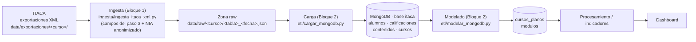
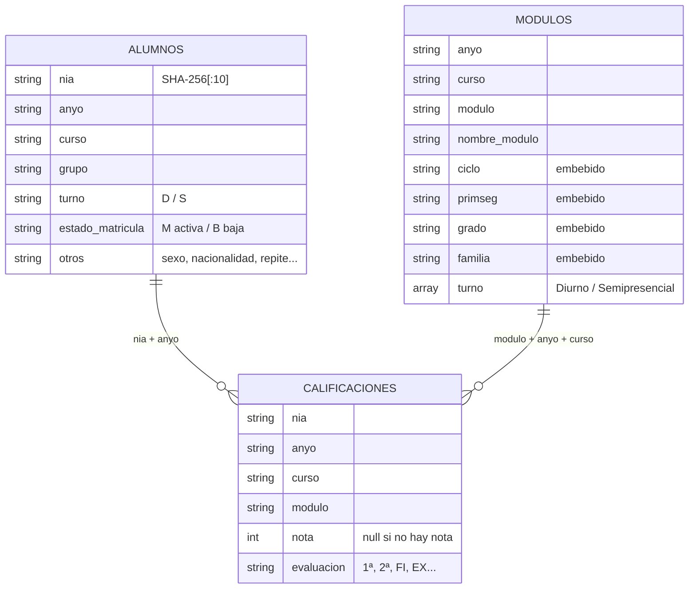
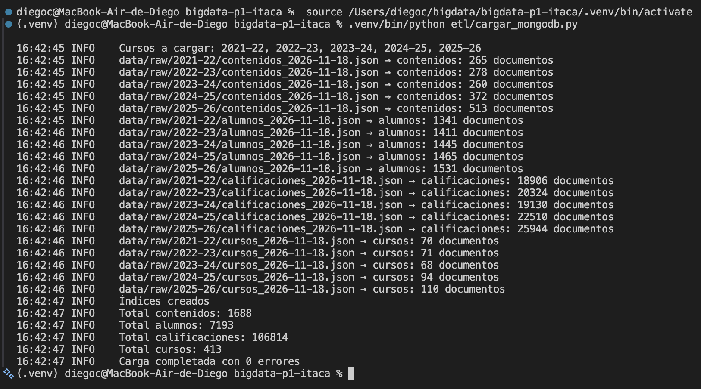
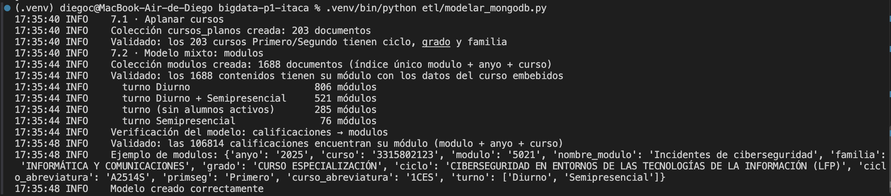
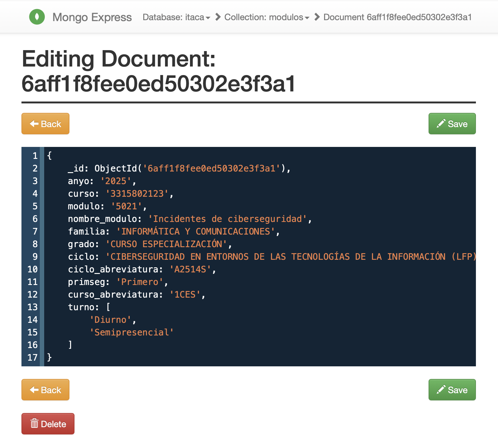
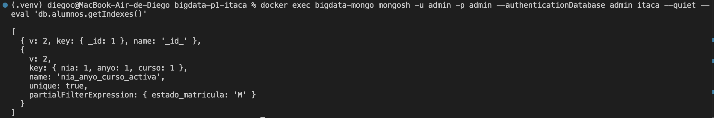

# Proyecto 1 · Ingesta de datos ITACA

## Descripción y objetivo

Este proyecto ingesta los datos académicos de ITACA (alumnado, cursos, módulos y calificaciones) a partir de sus exportaciones XML. Los deja anonimizados en la zona `raw` del proyecto para procesarlos y visualizarlos en los bloques siguientes.

- **Bloque 1:** ingesta de los XML a JSON anonimizado. Está escrita en Python y solo usa la biblioteca estándar (`xml.etree.ElementTree`, `json`, `hashlib` y `logging`).
- **Bloque 2:** carga de la zona raw en MongoDB y construcción de un modelo documental mixto, pensado para los indicadores del dashboard. Usa `pymongo`.

## Arquitectura



MongoDB y mongo-express se ejecutan en Docker con [`docker-compose.yml`](docker-compose.yml).

## Fuentes de datos

| | |
|---|---|
| **Origen** | ITACA (Conselleria d'Educació). Exportaciones XML del centro; en la práctica, el dataset de ejemplo del docente, que tiene la misma estructura. |
| **Mecanismo de acceso** | Ficheros XML exportados desde ITACA y copiados a `data/exportaciones/<curso>/`. No hace falta conexión ni credenciales. Los XML **no se suben a Git**. |
| **Cobertura** | Cinco cursos académicos: `2021-22` a `2025-26`. |
| **Frecuencia** | Cargas *batch* puntuales: una exportación por curso académico, que se repite cuando hay cambios (por ejemplo, al cerrar cada evaluación). Cada XML indica su fecha en el atributo `fechaExportacion` de la cabecera. |

Cada XML tiene una cabecera `<centro codigo=… denominacion=… curso="2025" fechaExportacion=…>` y, dentro, un contenedor con un nodo por registro. Los datos van en los atributos de cada nodo. El atributo `curso` de la cabecera (el año de inicio del curso) se guarda como **`Anyo`** en todas las tablas.

Tablas y campos que se ingestan:

| Tabla | Fichero | Campos extraídos |
|---|---|---|
| Alumnos | `alumnos.xml` | `Anyo, NIA, sexo, nacionalidad, provincia, municipio, ensenanza, curso, grupo, turno, linea, modalidad, repite, estado_matricula, tipo_matricula, fecha_matricula, fecha_ingreso_centro` |
| Cursos | `cursos.xml` | `Anyo, codigo, nombre_cas, nombre_val, abreviatura, ensenanza, padre` |
| Contenidos (módulos) | `contenidos.xml` | `Anyo, codigo, nombre_cas, nombre_val, ensenanza, curso` |
| Calificaciones | `calificaciones.xml` | `Anyo, evaluacion, alumno, ensenanza, curso, contenido, bloque_contenido, nota_numerica, tipo_nota` |

El XML de alumnos trae además datos personales: nombre, apellidos, fecha de nacimiento, documento, teléfonos, correos, SIP, expediente, código postal, localidad… **Esos campos no se extraen nunca.** La exportación incluye también `grupos.xml`. No se ingesta, pero se lee para validar que los grupos de los alumnos existen.

Relaciones entre tablas (por curso):

- `calificaciones.alumno` → `alumnos.NIA`
- `calificaciones.(contenido, curso)` → `contenidos.(codigo, curso)`

## Ingesta y anonimización

El script [`ingesta/ingesta_itaca_xml.py`](ingesta/ingesta_itaca_xml.py) recorre cada carpeta de curso, lee las cuatro tablas y escribe un JSON por tabla:

```bash
python ingesta/ingesta_itaca_xml.py
# o con rutas explícitas
python ingesta/ingesta_itaca_xml.py --entrada data/exportaciones --salida data/raw
```

```text
data/raw/
├── 2021-22/
│   ├── alumnos_2026-11-18.json
│   ├── calificaciones_2026-11-18.json
│   ├── contenidos_2026-11-18.json
│   └── cursos_2026-11-18.json
├── ...
└── 2025-26/
    └── ...
```

Cada fichero es una lista de objetos con los campos de la tabla anterior. La fecha del nombre es la de la ingesta, así se distinguen las distintas cargas.

**Anonimización del NIA.** El NIA se sustituye por un SHA-256 truncado a 10 caracteres, la función indicada en el enunciado:

```python
def anonimizar_nia(nia: str) -> str:
    return hashlib.sha256(str(nia).encode()).hexdigest()[:10]
```

Se aplica a `alumnos.NIA` y a `calificaciones.alumno` con la misma función, y el resultado se guarda en caché para que cada NIA se calcule una sola vez. Así las dos tablas siguen relacionadas sin guardar el NIA original. Además, en `alumnos` solo se guardan campos no identificativos.

**Buenas prácticas del script:**

- Registro con `logging` (nivel INFO): qué fichero se procesa, cuántos registros se guardan, avisos y errores.
- Cada XML se lee dentro de un `try/except` (`FileNotFoundError`, `ET.ParseError`, `ValueError`, `OSError`). Si un fichero falla, se registra cuál es y se sigue con el resto. El script termina con código 1 si hubo errores.
- Validación al final (paso 5):
  - todo `alumno` de calificaciones existe en alumnos;
  - todo `contenido` de calificaciones existe en contenidos;
  - todo `grupo` de alumnos existe en `grupos.xml` (los alumnos sin grupo asignado, 54 en total, se cuentan aparte);
  - ningún JSON de salida contiene campos identificativos ni NIA reales.
- Los datos de ITACA (`data/exportaciones/`, `data/raw/`) están en `.gitignore`.

**Limitación conocida:** el hash no lleva sal y el NIA tiene 8 dígitos, así que alguien con tiempo podría revertirlo por fuerza bruta. Para datos reales sería mejor un HMAC con una clave secreta guardada fuera del repositorio. Aquí se usa la función del enunciado para mantener la compatibilidad.

## Almacenamiento en MongoDB

### Puesta en marcha

1. Crear un fichero `.env` en la raíz con la contraseña de MongoDB (está en `.gitignore`):
   ```bash
   MONGO_PASSWORD=<contraseña>
   ```
   Opcionalmente, `MONGO_USER` (por defecto `admin`) y `MONGO_HOST` (por defecto `localhost:27017`).
2. Arrancar los contenedores:
   ```bash
   docker compose up -d     # MongoDB 7 (puerto 27017) y mongo-express (http://localhost:8081)
   docker compose down      # parar; los datos se conservan en el volumen mongo-data
   ```
   Los dos servicios tienen `restart: unless-stopped`: si un contenedor se cae, Docker lo vuelve a arrancar.
3. Instalar las dependencias (`pip install -r requirements.txt`) y ejecutar, en este orden:
   ```bash
   python ingesta/ingesta_itaca_xml.py   # Bloque 1: XML → data/raw
   python etl/cargar_mongodb.py          # raw → alumnos, calificaciones, contenidos, cursos
   python etl/modelar_mongodb.py         # 7.1 cursos_planos → 7.2 modulos
   ```
   `cargar_mongodb.py` acepta una lista de cursos (`python etl/cargar_mongodb.py 2025-26`). Los dos scripts vacían y regeneran sus colecciones, así que se pueden repetir sin duplicar datos.

### Modelo de datos

Se sigue el modelo mixto del enunciado. `calificaciones` es la colección grande y referencia a las demás. `modulos` **embebe** los datos aplanados de su curso (familia, grado, ciclo…), porque es una relación 1:1 y estable que siempre se consulta junta. `alumnos` va aparte, con un documento por matrícula.



| Colección | Origen | Documentos | Índices |
|---|---|---:|---|
| `alumnos` | `cargar_alumnos()` | 7 193 | `(nia, anyo, curso)` único y parcial (solo `estado_matricula: "M"`) |
| `calificaciones` | `cargar_calificaciones()` | 106 814 | `(curso, anyo, evaluacion)` y `nia` |
| `contenidos` | `cargar_contenidos()` | 1 688 | `(modulo, anyo, curso)` único |
| `cursos` | `cargar_cursos()` | 413 | `(codigo, anyo)` único |
| `cursos_planos` | `aplanar_cursos()` (7.1) | 203 | — (colección intermedia) |
| `modulos` | `crear_modulos()` (7.2) | 1 688 | `(modulo, anyo, curso)` único |

`contenidos`, `cursos` y `cursos_planos` son colecciones de trabajo a partir de las que se construye `modulos`. El modelo final para los indicadores son `alumnos`, `calificaciones` y `modulos`.

Transformaciones de la carga respecto a raw:

- Nombres de campo del enunciado: `NIA`/`alumno` → `nia`, `Anyo` → `anyo`, `contenido`/`codigo` → `modulo`, `nombre_cas` → `nombre_modulo`.
- `nota_numerica` (texto) → `nota` (entero, o `null` si viene vacía), para poder filtrar con `$lt: 5` o calcular medias.
- `evaluacion` `"01"`/`"02"` → `"1ª"`/`"2ª"`, como en los ejemplos del enunciado. Los demás códigos de ITACA (FI, EX…) se dejan igual.
- En `alumnos` no hay `fecha_nac` ni ningún otro dato personal, aunque aparezca en el ejemplo del enunciado: esos campos nunca llegan a raw (ver Bloque 1).

### Aplanado de cursos (7.1) y modelo mixto (7.2)

En `cursos` cada nodo apunta a su padre (`padre` → `codigo`): **Familia > Grado > Ciclo > Primero/Segundo**. `aplanar_cursos()` usa la agregación del enunciado: parte de los cursos Primero/Segundo y sube de abajo arriba con tres `$lookup` de la colección sobre sí misma. Cada `$lookup` devuelve un array, que el `$unwind` convierte en objeto. El resultado va a `cursos_planos` con `$out`.

`crear_modulos()` parte de `contenidos` y, con un `$lookup` de dos campos más `$unwind` y `$replaceRoot`/`$mergeObjects`, embebe en cada módulo los datos de su curso aplanado. Después calcula `turno` y guarda el resultado en `modulos` con `$out`. Ejemplo de documento:

```json
{
  "anyo": "2025", "curso": "3315802123", "modulo": "5021",
  "nombre_modulo": "Incidentes de ciberseguridad",
  "familia": "INFORMÁTICA Y COMUNICACIONES", "grado": "CURSO ESPECIALIZACIÓN",
  "ciclo": "CIBERSEGURIDAD EN ENTORNOS DE LAS TECNOLOGÍAS DE LA INFORMACIÓN (LFP)",
  "ciclo_abreviatura": "A2514S", "primseg": "Primero", "curso_abreviatura": "1CES",
  "turno": ["Diurno", "Semipresencial"]
}
```

### Adaptaciones respecto al enunciado

El código del enunciado es una plantilla. Estos son los cambios y su motivo:

| Enunciado | Implementación | Motivo |
|---|---|---|
| Un solo curso académico | Los cinco (`anyo` de `"2021"` a `"2025"`), con `anyo` también en `cursos_planos` | Permite comparar años en el dashboard. Los códigos de curso no se repiten entre años |
| Índice único `alumnos (nia, anyo)` | Único y **parcial** `(nia, anyo, curso)` con `estado_matricula: "M"` | El índice del enunciado es imposible con los datos reales: 114 alumnos tienen varias matrículas en el mismo año (normalmente una de baja, `B`, junto a la activa), y 7 de ellos tienen dos matrículas activas en cursos distintos. Así se conservan todas las matrículas y se garantiza que no haya dos **activas** por alumno, año y curso |
| Lookup 7.2 por `curso` + `grado = ensenanza` | Por `curso` + `anyo` | `grado` es un nombre (`"GRADO MEDIO"`) y `ensenanza` un código (`"5"`, igual en todos los ciclos): nunca coinciden y el lookup no encontraría nada. Se mantiene la forma (`let` con dos campos, `$unwind`, `$replaceRoot`/`$mergeObjects`) |
| `turno` en `modulos` | Array calculado con los turnos de las matrículas activas del curso | Ver el apartado siguiente |
| `fecha_nac` en `alumnos` | No se carga | Es un dato personal (corrección de la P1) |
| Credenciales en el código | `.env` | No subir contraseñas a Git |

**El campo `turno`.** Un módulo no tiene turno propio: lo tiene el grupo, y el mismo curso se imparte a la vez en grupos diurnos y semipresenciales (61 de los 169 cursos con alumnos activos). Ni `contenidos` ni `cursos` traen el turno, y la P1 no ingesta `grupos`. La solución es calcularlo en el propio pipeline de `modulos`: un `$lookup` a `alumnos` por `curso + anyo` con `estado_matricula: "M"`, los turnos distintos y su traducción (`D` → `"Diurno"`, `S` → `"Semipresencial"`, como confirman los nombres de los grupos «… SEMI»). El turno del alumno coincide con el de su grupo en 7 137 de 7 139 casos. Resultado:

| `turno` | Módulos |
|---|---:|
| `["Diurno"]` | 806 |
| `["Diurno", "Semipresencial"]` | 521 |
| `["Semipresencial"]` | 76 |
| `[]` (cursos sin alumnos activos ese año, casi todo tutorías y cursos no ofertados) | 285 |

Ventajas del array: se conserva el nombre de campo del enunciado y un documento por `(modulo, anyo, curso)`, así que el índice único sigue valiendo, y `find({turno: "Semipresencial"})` busca dentro del array. Se descartaron dos alternativas:

- sacar el turno de los alumnos con nota en el módulo: deja 424 módulos sin turno y mezcla alumnos de otros cursos con módulos pendientes;
- crear un documento por módulo y turno: rompe el índice único y complica el cruce con `calificaciones`.

Los vacíos se dejan como `[]`, sin inventar un valor.

### Validación y tolerancia a errores

`modelar_mongodb.py` valida cada paso antes de seguir con el siguiente:

1. `cursos_planos` tiene un documento por cada curso Primero/Segundo (203). Un `$unwind` descarta sin avisar los cursos a los que les falta un nivel de la jerarquía, y así no pasa desapercibido.
2. `modulos` tiene un documento por cada contenido (1 688) y ninguno se queda sin datos de curso.
3. Cada una de las 106 814 calificaciones encuentra exactamente un módulo por `modulo + anyo + curso`. Es el cruce que usarán los indicadores.

Los scripts se probaron provocando los fallos típicos (sobre una copia de raw y una base de pruebas):

| Situación | Comportamiento |
|---|---|
| MongoDB parado o contraseña incorrecta | Mensaje claro («¿Está arrancado? Prueba con: docker compose up -d» / «revisa .env») y fin con código 1 |
| Fichero raw ausente o JSON corrupto | Se registra cuál falla y la carga sigue con el resto de ficheros |
| Registro incompleto dentro de un JSON | Se descarta solo ese registro, con aviso, y se carga el resto del fichero |
| Valores duplicados en un índice único | Se indica qué clave choca y se crean los demás índices |
| Carga incompleta antes de modelar | La validación lo detecta (p. ej. «265 módulos no tienen datos de curso») y el modelado se detiene: cada paso depende del anterior. Como `$out` reemplaza la colección de forma atómica, si una agregación falla se conserva la versión anterior |
| Pérdida de conexión o Ctrl+C a mitad | Mensaje indicando que hay que volver a ejecutar el script |

Todos los mensajes van por `logging`. Los scripts terminan con código 0 si todo fue bien y 1 si hubo cualquier error.

## Bitácora de prácticas

### Bloque 1 · P1: Ingesta de datos ITACA (XML)

**Proceso seguido**

1. Análisis de los XML: estructura `<centro>` → contenedor → nodos con atributos. Se identificaron los campos de cada tabla y las relaciones entre ellas (ver «Fuentes de datos»).
2. Script `ingesta/ingesta_itaca_xml.py`: extrae los campos del paso 3, toma `Anyo` de la cabecera, anonimiza el NIA y guarda `data/raw/<curso>/<tabla>_<fecha>.json`.
3. Ejecución sobre los cinco cursos y validación de claves y de datos identificativos.

**Resultado** (ejecución del 18/11/2026; 20 ficheros, 0 errores):

| Curso | alumnos | cursos | contenidos | calificaciones |
|---|---:|---:|---:|---:|
| 2021-22 | 1 341 | 70 | 265 | 18 906 |
| 2022-23 | 1 411 | 71 | 278 | 20 324 |
| 2023-24 | 1 445 | 68 | 260 | 19 130 |
| 2024-25 | 1 465 | 94 | 372 | 22 510 |
| 2025-26 | 1 531 | 110 | 513 | 25 944 |

Salida del script (resumida):

```text
INFO    Procesando curso 2021-22
INFO    Guardado data/raw/2021-22/alumnos_2026-11-18.json (1341 registros)
INFO    Guardado data/raw/2021-22/cursos_2026-11-18.json (70 registros)
INFO    Guardado data/raw/2021-22/contenidos_2026-11-18.json (265 registros)
INFO    Guardado data/raw/2021-22/calificaciones_2026-11-18.json (18906 registros)
INFO    2021-22: claves coherentes (alumnos y contenidos de calificaciones existen)
INFO    2021-22: todos los grupos de alumnos existen en grupos.xml (0 alumnos sin grupo asignado)
...
WARNING 2023-24: 188 calificaciones (9 alumnos distintos) referencian alumnos que no están en alumnos
...
INFO    Comprobado: ningún fichero de salida contiene datos identificativos ni NIA reales
INFO    Ingesta terminada: 20 ficheros generados, 0 errores, 1 avisos
```

Ejemplo de registro de `alumnos` (NIA anonimizado, sin datos personales):

```json
{"Anyo": "2025", "NIA": "0d5788cc76", "sexo": "M", "nacionalidad": "804", "provincia": "46",
 "municipio": "213", "ensenanza": "5", "curso": "3306169702", "grupo": "2CFSR", "turno": "S",
 "linea": "1", "modalidad": "COM", "repite": "2", "estado_matricula": "M", "tipo_matricula": "",
 "fecha_matricula": "10/07/2025", "fecha_ingreso_centro": "01/09/2024"}
```

**Decisiones tomadas**

- **Anonimización:** además de hashear el NIA, en `alumnos` solo se guardan los campos del paso 3. Así ningún dato identificativo directo (nombre, apellidos, documento, contacto…) llega a `raw`. Una primera versión guardaba `nombre`, y eso anulaba la anonimización; se corrigió tras la revisión del profesor.
- **`Anyo`:** se toma del atributo `curso` de la cabecera del XML (por ejemplo `2025`), no del nombre de la carpeta.
- **Un JSON por tabla y por curso**, con la fecha de ingesta en el nombre del fichero.
- **Incidencia en los datos de origen:** en 2023-24 hay 188 calificaciones (de 9 alumnos) cuyo alumno no aparece en `alumnos.xml`. Se mantienen en `raw`, que debe reflejar la fuente tal cual, y el script lo avisa con un *warning*. Se tratarán en la fase de procesamiento.

### Bloque 2 · Modelado en MongoDB (Proyecto 1)

**Proceso seguido**

1. Docker con MongoDB 7 y mongo-express (`docker-compose.yml`), con la contraseña en `.env`.
2. Análisis de los datos para elegir el modelo: la jerarquía de cursos está completa en los cinco años, todos los contenidos cuelgan de un curso Primero/Segundo y los códigos de curso no se repiten entre años. Al revisar los datos aparecieron los problemas del índice de `alumnos` y del `turno`, que se consultaron con el profesor.
3. `etl/cargar_mongodb.py`: carga de raw con las funciones del enunciado (`cargar_contenidos()`, `cargar_alumnos()`, `cargar_calificaciones()`) y `cargar_cursos()`, más los índices.
4. `etl/modelar_mongodb.py`: aplanado de cursos (7.1), modelo mixto `modulos` (7.2) y validación del cruce con `calificaciones`.
5. Pruebas de robustez provocando los fallos típicos (ver «Validación y tolerancia a errores»).

**Resultado de la carga** (cinco cursos, 0 errores):



**Resultado del modelado:** 203 cursos aplanados, 1 688 módulos con el curso embebido, el reparto de turnos y las 106 814 calificaciones cruzadas con su módulo:



**Documento de `modulos` en mongo-express**, con los datos del curso embebidos y `turno` como array:



**Índice único parcial de `alumnos`** (`db.alumnos.getIndexes()` en mongosh). Se probó que rechaza una segunda matrícula activa del mismo alumno, año y curso, y que admite una de baja:



**Decisiones tomadas**

- **Cinco cursos académicos**, no uno, para poder comparar años en el dashboard.
- **Índice de `alumnos` único y parcial** sobre las matrículas activas, en lugar del `(nia, anyo)` único del enunciado, que los datos no permiten. El profesor dejó elegir la solución; se escogió la que conserva todas las matrículas (también las bajas, útiles para la limpieza de datos) y a la vez garantiza la unicidad de las activas.
- **`turno` como array calculado en Mongo.** El profesor lo planteó como una complicación puesta adrede para resolverla nosotros. Ver «El campo `turno`».
- **Lookup 7.2 por `curso + anyo`**, porque el del enunciado compara campos de distinto tipo.
- **Un script para la carga y otro para el modelado**: la carga es el `etl/cargar_mongodb.py` del enunciado y el modelado agrupa el 7.1 y el 7.2, que forman un mismo flujo (`modulos` necesita `cursos_planos`).

**Dudas abiertas** (consultadas con el profesor, sin respuesta todavía). No afectan al modelo, pero sí a los indicadores:

- Qué significan los códigos de evaluación distintos de `01`/`02` (FI, EX, FO, PO, P1…).
- Si la nota 0 significa «no presentado». En la 2ª evaluación de 2025 son el 15 % de las notas. Si es así, habría que excluirlas de las medias.
