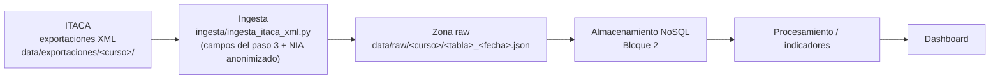

# Proyecto 1 · Ingesta de datos ITACA

## Descripción y objetivo

Este proyecto ingesta los datos académicos de ITACA (alumnado, cursos, módulos y calificaciones) a partir de sus exportaciones XML. Los deja anonimizados en la zona `raw` del proyecto para procesarlos y visualizarlos en los bloques siguientes.

La ingesta del Bloque 1 está escrita en Python y solo usa la biblioteca estándar (`xml.etree.ElementTree`, `json`, `hashlib` y `logging`).

## Arquitectura



## Fuentes de datos

| | |
|---|---|
| **Origen** | ITACA (Conselleria d'Educació). Exportaciones XML del centro; en la práctica, el dataset de ejemplo del docente, que tiene la misma estructura. |
| **Mecanismo de acceso** | Ficheros XML exportados desde ITACA y copiados a `data/exportaciones/<curso>/`. No hace falta conexión ni credenciales. Los XML **no se suben a Git**. |
| **Cobertura** | Cinco cursos académicos: `2021-22` a `2025-26`. |
| **Frecuencia** | Cargas *batch* puntuales: una exportación por curso académico, que se repite cuando hay cambios (por ejemplo, al cerrar cada evaluación). Cada XML indica su fecha en el atributo `fechaExportacion` de la cabecera. |

Cada XML tiene una cabecera `<centro codigo=… denominacion=… curso="2025" fechaExportacion=…>` y, dentro, un contenedor con un nodo por registro. Los datos van en los atributos de cada nodo. El atributo `curso` de la cabecera (el año de inicio del curso) se guarda como **`Anyo`** en todas las tablas.

Tablas y campos que se ingestan:

| Tabla | Fichero | Campos extraídos |
|---|---|---|
| Alumnos | `alumnos.xml` | `Anyo, NIA, sexo, nacionalidad, provincia, municipio, ensenanza, curso, grupo, turno, linea, modalidad, repite, estado_matricula, tipo_matricula, fecha_matricula, fecha_ingreso_centro` |
| Cursos | `cursos.xml` | `Anyo, codigo, nombre_cas, nombre_val, abreviatura, ensenanza, padre` |
| Contenidos (módulos) | `contenidos.xml` | `Anyo, codigo, nombre_cas, nombre_val, ensenanza, curso` |
| Calificaciones | `calificaciones.xml` | `Anyo, evaluacion, alumno, ensenanza, curso, contenido, bloque_contenido, nota_numerica, tipo_nota` |

El XML de alumnos trae además datos personales: nombre, apellidos, fecha de nacimiento, documento, teléfonos, correos, SIP, expediente, código postal, localidad… **Esos campos no se extraen nunca.** La exportación incluye también `grupos.xml`, que este bloque no ingesta.

Relaciones entre tablas (por curso):

- `calificaciones.alumno` → `alumnos.NIA`
- `calificaciones.(contenido, curso)` → `contenidos.(codigo, curso)`

## Ingesta y anonimización

El script [`ingesta/ingesta_itaca_xml.py`](ingesta/ingesta_itaca_xml.py) recorre cada carpeta de curso, lee las cuatro tablas y escribe un JSON por tabla:

```bash
python ingesta/ingesta_itaca_xml.py
# o con rutas explícitas
python ingesta/ingesta_itaca_xml.py --entrada data/exportaciones --salida data/raw
```

```text
data/raw/
├── 2021-22/
│   ├── alumnos_2026-11-18.json
│   ├── calificaciones_2026-11-18.json
│   ├── contenidos_2026-11-18.json
│   └── cursos_2026-11-18.json
├── ...
└── 2025-26/
    └── ...
```

Cada fichero es una lista de objetos con los campos de la tabla anterior. La fecha del nombre es la de la ingesta, así se distinguen las distintas cargas.

**Anonimización del NIA.** El NIA se sustituye por un SHA-256 truncado a 10 caracteres, la función indicada en el enunciado:

```python
def anonimizar_nia(nia: str) -> str:
    return hashlib.sha256(str(nia).encode()).hexdigest()[:10]
```

Se aplica a `alumnos.NIA` y a `calificaciones.alumno` con la misma función, y el resultado se guarda en caché para que cada NIA se calcule una sola vez. Así las dos tablas siguen relacionadas sin guardar el NIA original. Además, en `alumnos` solo se guardan campos no identificativos.

**Buenas prácticas del script:**

- Registro con `logging` (nivel INFO): qué fichero se procesa, cuántos registros se guardan, avisos y errores.
- Cada XML se lee dentro de un `try/except` (`FileNotFoundError`, `ET.ParseError`, `ValueError`, `OSError`). Si un fichero falla, se registra cuál es y se sigue con el resto. El script termina con código 1 si hubo errores.
- Validación al final (paso 5):
  - todo `alumno` de calificaciones existe en alumnos;
  - todo `contenido` de calificaciones existe en contenidos;
  - ningún JSON de salida contiene campos identificativos ni NIA reales.
- Los datos de ITACA (`data/exportaciones/`, `data/raw/`) están en `.gitignore`.

**Limitación conocida:** el hash no lleva sal y el NIA tiene 8 dígitos, así que alguien con tiempo podría revertirlo por fuerza bruta. Para datos reales sería mejor un HMAC con una clave secreta guardada fuera del repositorio. Aquí se usa la función del enunciado para mantener la compatibilidad.

## Bitácora de prácticas

### Bloque 1 · P1: Ingesta de datos ITACA (XML)

**Proceso seguido**

1. Análisis de los XML: estructura `<centro>` → contenedor → nodos con atributos. Se identificaron los campos de cada tabla y las relaciones entre ellas (ver «Fuentes de datos»).
2. Script `ingesta/ingesta_itaca_xml.py`: extrae los campos del paso 3, toma `Anyo` de la cabecera, anonimiza el NIA y guarda `data/raw/<curso>/<tabla>_<fecha>.json`.
3. Ejecución sobre los cinco cursos y validación de claves y de datos identificativos.

**Resultado** (ejecución del 18/11/2026; 20 ficheros, 0 errores):

| Curso | alumnos | cursos | contenidos | calificaciones |
|---|---:|---:|---:|---:|
| 2021-22 | 1 341 | 70 | 265 | 18 906 |
| 2022-23 | 1 411 | 71 | 278 | 20 324 |
| 2023-24 | 1 445 | 68 | 260 | 19 130 |
| 2024-25 | 1 465 | 94 | 372 | 22 510 |
| 2025-26 | 1 531 | 110 | 513 | 25 944 |

Salida del script (resumida):

```text
INFO    Procesando curso 2021-22
INFO    Guardado data/raw/2021-22/alumnos_2026-11-18.json (1341 registros)
INFO    Guardado data/raw/2021-22/cursos_2026-11-18.json (70 registros)
INFO    Guardado data/raw/2021-22/contenidos_2026-11-18.json (265 registros)
INFO    Guardado data/raw/2021-22/calificaciones_2026-11-18.json (18906 registros)
INFO    2021-22: claves coherentes (alumnos y contenidos de calificaciones existen)
...
WARNING 2023-24: 188 calificaciones (9 alumnos distintos) referencian alumnos que no están en alumnos
...
INFO    Comprobado: ningún fichero de salida contiene datos identificativos ni NIA reales
INFO    Ingesta terminada: 20 ficheros generados, 0 errores, 1 avisos
```

Ejemplo de registro de `alumnos` (NIA anonimizado, sin datos personales):

```json
{"Anyo": "2025", "NIA": "0d5788cc76", "sexo": "M", "nacionalidad": "804", "provincia": "46",
 "municipio": "213", "ensenanza": "5", "curso": "3306169702", "grupo": "2CFSR", "turno": "S",
 "linea": "1", "modalidad": "COM", "repite": "2", "estado_matricula": "M", "tipo_matricula": "",
 "fecha_matricula": "10/07/2025", "fecha_ingreso_centro": "01/09/2024"}
```

**Decisiones tomadas**

- **Anonimización:** además de hashear el NIA, en `alumnos` solo se guardan los campos del paso 3. Así ningún dato identificativo directo (nombre, apellidos, documento, contacto…) llega a `raw`. Una primera versión guardaba `nombre`, y eso anulaba la anonimización; se corrigió tras la revisión del profesor.
- **`Anyo`:** se toma del atributo `curso` de la cabecera del XML (por ejemplo `2025`), no del nombre de la carpeta.
- **Un JSON por tabla y por curso**, con la fecha de ingesta en el nombre del fichero.
- **Incidencia en los datos de origen:** en 2023-24 hay 188 calificaciones (de 9 alumnos) cuyo alumno no aparece en `alumnos.xml`. Se mantienen en `raw`, que debe reflejar la fuente tal cual, y el script lo avisa con un *warning*. Se tratarán en la fase de procesamiento.
