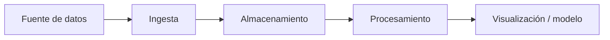

# Proyecto 1 · Ingesta de datos ITACA

## Descripción y objetivo

Mediante este proyecto se busca extraer los datos de los alumnos de la plataforma ITACA usando la librería de "Pandas".

## Arquitectura

*Diagrama del pipeline completo. Empieza con uno provisional en el Bloque 0 y actualízalo al terminar cada bloque.*


## Fuentes de datos

Los datos se obtienen de unas tablas XML, obtenidos mediante cargas puntuales repartidas en distintos años.




## Ingesta y anonimización

El script `ingesta/anonimizar_alumnos.py` convierte los XML de `data/exportaciones/` a JSON en `data/raw/`, replicando la estructura de carpetas y los nombres de fichero originales. Solo cambia la extensión: `.xml` → `.json`.

```bash
python ingesta/anonimizar_alumnos.py
```

Ejemplo de salida:

```text
data/raw/
├── 2021-22/
│   ├── alumnos.json
│   ├── calificaciones.json
│   ├── contenidos.json
│   ├── cursos.json
│   └── grupos.json
├── 2022-23/
│   └── ...
└── 2025-26/
    └── ...
```

Los identificadores de alumno se anonimizarán con SHA-256 truncado a 10 caracteres, tal y como indicó el profesor:

```python
import hashlib

def anonimizar_nia(nia: str) -> str:
    return hashlib.sha256(str(nia).encode()).hexdigest()[:10]
```

El mismo hash se aplica al campo `NIA` de `alumnos.json` y al campo `alumno` de `calificaciones.json`, que referencia al mismo identificador. Así se pueden relacionar alumnos y calificaciones sin conservar el NIA original. Cada `alumnos.json` es una lista de objetos con solo `anyo`, `NIA`, `nombre`, `grupo` y `curso`; `anyo` toma el nombre de la carpeta del curso académico (por ejemplo, `2025-26`). Los demás JSON mantienen los metadatos de `centro`, todos sus campos de origen y el orden de los registros. La carpeta `data/raw/` está excluida en `.gitignore`.

